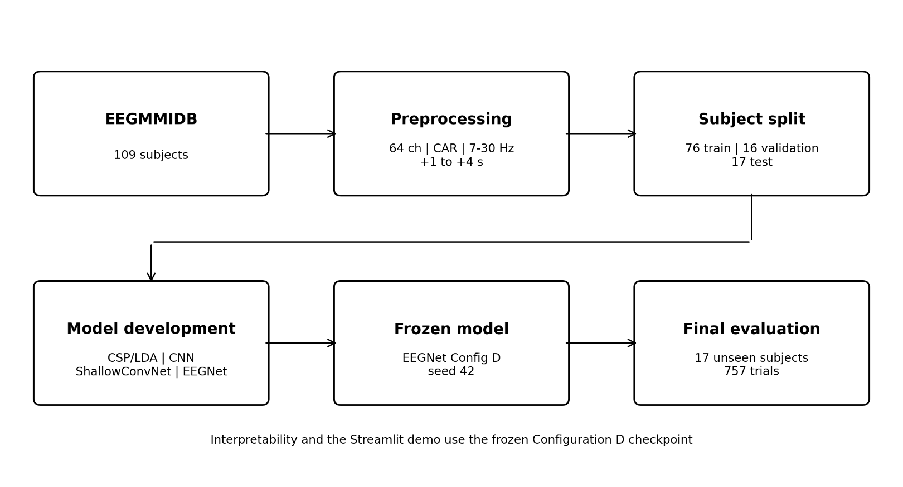
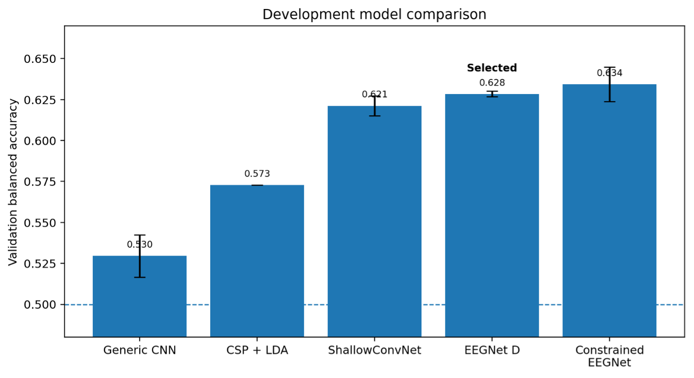
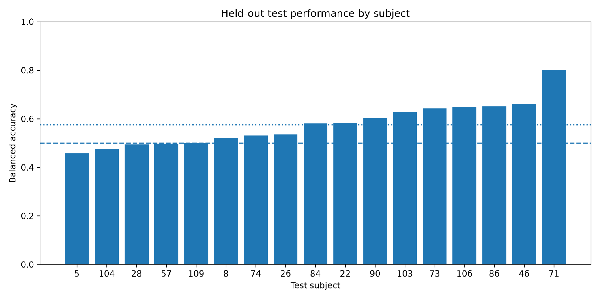
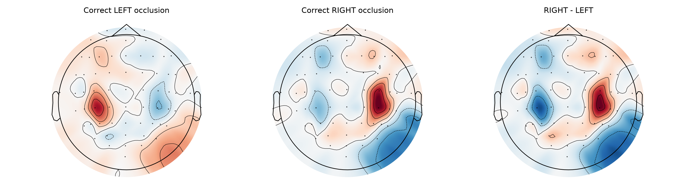

# NeuroSignalLab

**Subject-independent motor-imagery EEG decoding using classical machine learning, EEG-specific deep learning, and model interpretability.**

NeuroSignalLab is an offline EEG-decoding research project exploring how reliably models can distinguish imagined left- versus right-fist movement in people who were not seen during training.

The project follows a complete machine-learning pipeline:

**EEG data → preprocessing → subject-independent evaluation → model comparison → frozen inference → held-out testing → interpretability**

The final system uses a compact EEGNet model and includes a Streamlit research demo, reusable inference code, saved evaluation results, and a technical report.

**Final result:** 57.6% balanced accuracy across 757 trials from 17 previously unseen subjects.



---

## Why I built this

I started NeuroSignalLab because I wanted to understand how biological signals can be translated into computational systems.

As a medical student, I am learning how the nervous system works physiologically. As an informatics student, I am learning how complex data can be modeled computationally.

Through my research at a neurophysiology lab, I learned how to study brain signals and connectivity patterns quantitatively, which furthered my curiousity in combining these two interests into a concrete technical project. 

Rather than only training a classifier, I wanted to understand the entire process:

- how EEG should be preprocessed,
- how evaluation design changes apparent performance,
- how classical and neural approaches compare,
- how well models transfer between people,
- how reproducible neural-network results are,
- and what interpretability methods can and cannot tell us about a trained model.

---

## Research questions

NeuroSignalLab was built around two questions:

1. **How reliably can classical machine-learning and EEG-specific deep-learning models decode left-versus-right motor imagery from open EEG recordings?**

2. **What do preprocessing, subject-independent evaluation, and model analysis reveal about the limits of EEG machine learning?**

The focus is on understanding generalization, reproducibility, and model limitations.

---

## Dataset

The project uses the **PhysioNet EEG Motor Movement/Imagery Dataset (EEGMMIDB)**.

The final analysis contains:

| Dataset property | Value |
|---|---:|
| Subjects | 109 |
| EEG channels | 64 |
| Motor-imagery runs | 4, 8, 12 |
| Classes | Imagined left fist / imagined right fist |
| Processed trials | 4,898 |
| Sampling rate | 160 Hz |

For the selected motor-imagery runs:

- `T1` → imagined left fist → class `0`
- `T2` → imagined right fist → class `1`
- `T0` → rest → not used as a classification class

The full raw EEG dataset is not redistributed in this repository.

Dataset source:

**PhysioNet EEG Motor Movement/Imagery Dataset**  
https://physionet.org/content/eegmmidb/1.0.0/

## License
This project´s source code is licensed under the MIT License. 

The datasets in this project are not redistributed in this repository. The datasets are governed by their own original licenses, access conditions and citation requirements. Please refer to the original dataset providers for dataset access, citation requirements and terms of use. 

## Preprocessing

The final preprocessing pipeline was locked before model selection.

Each recording was processed using:

- all 64 EEG channels
- common-average reference
- 7–30 Hz FIR band-pass filtering
- task epochs from −1 to +4 s
- model input window from +1 to +4 s
- no voltage baseline correction
- sampling rate of 160 Hz
- final trial shape: `64 × 481`

The saved EEG arrays remain in volts. Neural-network inputs are in microvolt.

Subject 88 originally contained a different sampling rate and was harmonized before event extraction.

Six previously identified irregular recordings were flagged rather than removed:

`S088, S089, S092, S100, S104, S106`

No subject was excluded because of poor model performance.

## Subject-independent evaluation

A major goal of NeuroSignalLab was to avoid leakage between people.

Subjects rather than individual EEG trials were divided into:

| Split | Subjects | Trials |
|---|---:|---:|
| Training | 76 | 3,423 |
| Validation | 16 | 718 |
| Test | 17 | 757 |
| **Total** | **109** | **4,898** |

The split was created using seed `42`.

The 17 test subjects were kept completely separate during development.

The test cohort was opened only after the Configuration D EEGNet was trained on seed 42, and the checkpoint had been locked.

## Evaluation design matters

Before training the final deep-learning models, CSP + LDA was used to investigate how evaluation design affected performance.

| Evaluation | Mean balanced accuracy |
|---|---:|
| Within-subject run-wise | 0.597 |
| Fixed cross-subject | 0.565 |
| Nested tuned cross-subject | 0.575 |

The within-subject to cross-subject decrease was approximately **3.2 percentage points** (`p = 0.0044`).

Nested CSP tuning increased mean cross-subject BA by approximately **1 percentage point**, but the improvement was not statistically significant (`p = 0.1582`).

These experiments used a different evaluation setup from the later train/validation/test model comparison and are reported separately.

## Model development

Five model configurations were compared during development:

### CSP + LDA

A classical EEG baseline using **Common Spatial Patterns** for spatial feature extraction followed by Linear Discriminant Analysis.

Because common-average referencing makes one channel-space direction effectively redundant, CSP was fitted with EEG rank `63`.

### Generic CNN

A simple 1D convolutional network consisting of:

- two temporal convolution layers
- ReLU activations
- max pooling
- final linear classifier

This model intentionally contained less EEG-specific architectural structure.

### ShallowConvNet

The Braindecode `ShallowFBCSPNet` architecture was used as an established EEG-specific convolutional model.

### EEGNet

EEGNet uses:

- temporal convolution
- depthwise spatial convolution
- separable temporal convolution
- average pooling
- dropout
- linear classification

Two EEGNet configurations were evaluated:

- **Configuration D**
- **Max-norm-constrained EEGNet**

---

## Development results



| Model | Validation balanced accuracy |
|---|---:|
| Generic CNN | 0.530 ± 0.014 |
| CSP + LDA | 0.573 |
| ShallowConvNet | 0.621 ± 0.007 |
| **EEGNet Configuration D** | **0.628 ± 0.002** |
| Constrained EEGNet | 0.634 ± 0.012 |

For neural-network models, values are **mean ± standard deviation across five random seeds**: `42, 123, 456, 789, 2026`

The constrained EEGNet achieved the highest mean validation balanced accuracy, but Configuration D was more consistent across seeds.

Configuration D:

`0.628446 ± 0.001923`

Constrained EEGNet:

`0.634246 ± 0.011780`

For this reason, **Configuration D was selected as the primary NeuroSignalLab model**.

---

## Final model

The locked model is:

**EEGNet Configuration D — seed 42**

Training configuration:

| Parameter | Value |
|---|---:|
| Learning rate | `1e-3` |
| Dropout | `0.50` |
| Weight decay | `1e-4` |
| Batch size | `32` |
| Maximum epochs | `30` |
| Max-norm | None |
| Selected epoch | `19` |

Locked checkpoint: `models/config_d_seed42_best.pt`

Validation balanced accuracy of this exact checkpoint: 0.6277

## Final held-out evaluation

The frozen model was evaluated **once** on the 17-subject test cohort.

| Metric | Final result |
|---|---:|
| Accuracy | 0.5760 |
| **Balanced accuracy** | **0.5756** |
| Macro F1 | 0.5721 |
| Test subjects | 17 |
| Test trials | 757 |
| Mean subject BA | 0.5776 |
| Median subject BA | 0.5810 |
| Subject BA range | 0.458–0.801 |

The final confusion matrix was:

| | Predicted left | Predicted right |
|---|---:|---:|
| **True left** | 254 | 126 |
| **True right** | 195 | 182 |

Left-class recall was approximately `66.8%`.

Right-class recall was approximately `48.3%`.

The frozen checkpoint decreased from `62.8%` validation BA to `57.6%` test BA.

### Performance varied substantially between subjects




Twelve of the 17 test subjects had balanced accuracy above `0.50`, one had exactly `0.50`, and four were below `0.50`.

The strongest subject reached approximately `0.80` BA while the weakest reached approximately `0.46`.

No model, preprocessing, threshold, subject-selection, or training changes were made after observing the test result.

No pre-specified statistical test against chance was performed, so the project reports the observed performance without making a formal claim above chance.

## Interpretability

NeuroSignalLab includes several methods for examining the frozen model:

- gradient saliency
- channel occlusion
- temporal occlusion
- learned temporal-filter inspection

### Channel occlusion

Channel occlusion removes one EEG channel at a time and measures the resulting change in the target-class logit.

For group-level analysis, results were first averaged within each subject and then across subjects.

Correct left-imagery predictions showed the strongest average sensitivity around:

- CP3
- C3
- P3
- CP1

Correct right-imagery predictions showed the strongest average sensitivity around:

- CP4
- C4
- CP6
- P4



These plots describe **model sensitivity at the electrode level**.

## Learned temporal filters

The first EEGNet convolution contains eight learned temporal kernels.

Each kernel:

- contains 40 weights
- spans 250 ms at 160 Hz

Their Fourier magnitude responses showed different frequency sensitivities within the model's 7–30 Hz input band.

Peak normalized magnitude responses were distributed approximately between **12 and 28 Hz**.

These filters should not be interpreted as “mu” or “beta” detectors.

---

## Saliency sanity check

Gradient saliency was compared with saliency generated by a randomly initialized EEGNet for ten validation trials.

The correlation between trained and random saliency maps had:

mean ≈ -0.13
range ≈ -0.20 to -0.02


This showed that the trained network parameters affected the observed saliency patterns.

## Interactive demo

NeuroSignalLab includes a Streamlit research demo: `app/streamlit_app.py`


The app allows a user to:

- select a preprocessed validation EEG trial
- inspect trial metadata
- visualize an EEG waveform
- run the frozen Configuration D EEGNet
- view the predicted left/right class
- inspect left/right **model outputs**
- view channel-occlusion sensitivity

The app uses **validation examples only**. The final test set is not exposed as an interactive analysis surface.

Softmax values are shown as **model outputs**, not calibrated confidence estimates.

The current app is an offline research demonstration. It does not accept live EEG or operate as a real-time BCI.

---

## Technical report

A full description of the project design, experiments, results, interpretation, and limitations is available here:

**[NeuroSignalLab Technical Report](reports/NeuroSignalLab_Technical_Report.pdf)**

The technical report is the main scientific description of the completed project.

## Repository structure

```text
neurosignallab/
│
├── README.md
├── LICENSE
├── requirements.txt
├── .gitignore
│
├── app/
│   ├── streamlit_app.py
│   └── model_utils.py
│
├── data/
│   ├── README.md
│   ├── sample/
│   └── processed/              # generated locally / not redistributed
│
├── figures/
│   ├── figure1_pipeline.png
│   ├── figure2_model_comparison.png
│   ├── figure3a_subject_performance.png
│   ├── figure3b_confusion_matrix.png
│   └── week15_occlusion_topomap.png
│
├── models/
│   └── config_d_seed42_best.pt
│
├── notebooks/
│   ├── 02_preprocess_and_epoch_motor_imagery.ipynb
│   ├── 03_validate_preprocessing.ipynb
│   ├── 04_csp_lda_baseline.ipynb
│   ├── 05_cross_subject_generalization.ipynb
│   ├── 06_nested_cv_csp_tuning.ipynb
│   ├── 07_classical_model_statistics_and_robustness.ipynb
│   ├── 08_pytorch_baseline_cnn.ipynb
│   ├── 09_train_baseline_cnn.ipynb
│   ├── 10_eegnet.ipynb
│   ├── 11_eegnet_reproducibility.ipynb
│   ├── 11b_eegnet_faithful_and_subject_analysis.ipynb
│   ├── 12_model_comparison.ipynb
│   ├── 13_inference_pipeline.ipynb
│   ├── 15_interpretability.ipynb
│   ├── 17_final_test_evaluation.ipynb
│   └── 18_learned_filters.ipynb
│
├── notes/
│   ├── reading_notes.md
│   ├── project_story.md
│   ├── preprocessing_protocol.md
│   ├── limitations_clinical_validity.md
│   └── claims_audit.md
│
├── reports/
│   └── NeuroSignalLab_Technical_Report.pdf
│
├── results/
│   ├── week9_subject_split.csv
│   ├── week17_final_test_metrics.csv
│   ├── week17_final_subject_metrics.csv
│   ├── week17_final_predictions.csv
│   └── ...
│
└── src/
    └── neurosignallab/
        ├── __init__.py
        ├── preprocessing.py
        ├── models.py
        ├── train.py
        ├── interpretability.py
        └── inference.py
```

`Notebooks` contain experiments and analysis.

`src/neurosignallab/` contains reusable finalized code.

`app/` contains the presentation layer.

---

## Installation

Clone the repository:

```bash
git clone https://github.com/henrikchan-ops/neurosignallab.git
cd neurosignallab
```

Create and activate a virtual environment:

```bash
python -m venv .venv
source .venv/bin/activate
```

On Windows:

```bash
.venv\Scripts\activate
```

Install dependencies:

```bash
pip install -r requirements.txt
```

## Running the Streamlit demo

From the repository root:

```bash
streamlit run app/streamlit_app.py
```

The application requires the model checkpoint and the designated validation data expected by the app.

---

## Reproducing the analysis

The major experimental progression is:

```text
preprocessing
    ↓
preprocessing validation
    ↓
CSP + LDA baseline
    ↓
cross-subject evaluation
    ↓
nested CSP tuning
    ↓
statistical / robustness analysis
    ↓
generic CNN
    ↓
EEGNet
    ↓
multi-seed reproducibility
    ↓
model comparison
    ↓
frozen inference pipeline
    ↓
interpretability
    ↓
final held-out evaluation
    ↓
learned-filter inspection
```

The exact subject split is stored in:

```text
results/week9_subject_split.csv
```

The final frozen checkpoint is:

```text
models/config_d_seed42_best.pt
```

The final test results are stored in:

```text
results/week17_final_test_metrics.csv
results/week17_final_subject_metrics.csv
results/week17_final_predictions.csv
```

The final test set should be treated as a reporting result and **not reused for additional model development**.

---

## Limitations

The main limitations of NeuroSignalLab are:

- performance varies substantially between subjects
- the final test result is modest
- the project uses one public dataset
- only two cue-based motor-imagery classes are studied
- there is no independent external dataset
- softmax outputs were not calibrated
- interpretability methods describe model sensitivity rather than physiological causality
- the final test evaluates one frozen seed-42 checkpoint
- there is no live EEG acquisition or online BCI pipeline
- no patients or clinical outcomes were studied

Future work could investigate:

- subject-specific calibration
- transfer learning
- domain adaptation
- session-to-session robustness
- independent external validation
- online EEG streaming
- closed-loop BCI feedback

These are future research directions and are **not existing NeuroSignalLab capabilities**.

---

## Research and medical disclaimer

NeuroSignalLab is an **educational and research project**.

It is not:

- a medical device
- a diagnostic system
- a clinical decision-support tool
- a rehabilitation intervention
- a real-time BCI

The models and visualizations in this repository should not be used to diagnose, monitor, treat, or predict neurological disease.

NeuroSignalLab performs offline classification of previously recorded EEG and implements only the decoding component that could form part of a larger BCI system.

---

## Data and licensing

The repository does not redistribute the full EEGMMIDB dataset.

Users should obtain the data directly from PhysioNet and follow the original dataset license, citation requirements, and access conditions.

Project source code is licensed under the **MIT License**.

---

## References

1. Schalk, G. *EEG Motor Movement/Imagery Dataset.* PhysioNet, Version 1.0.0, 2009.  
   DOI: `10.13026/C28G6P`

2. Schalk, G., McFarland, D. J., Hinterberger, T., Birbaumer, N., & Wolpaw, J. R.  
   *BCI2000: A General-Purpose Brain-Computer Interface (BCI) System.*  
   IEEE Transactions on Biomedical Engineering, 51(6), 1034–1043, 2004.  
   DOI: `10.1109/TBME.2004.827072`

3. Ramoser, H., Müller-Gerking, J., & Pfurtscheller, G.  
   *Optimal spatial filtering of single trial EEG during imagined hand movement.*  
   IEEE Transactions on Rehabilitation Engineering, 8(4), 441–446, 2000.  
   DOI: `10.1109/86.895946`

4. Schirrmeister, R. T., et al.  
   *Deep learning with convolutional neural networks for EEG decoding and visualization.*  
   Human Brain Mapping, 38(11), 5391–5420, 2017.  
   DOI: `10.1002/hbm.23730`

5. Lawhern, V. J., et al.  
   *EEGNet: a compact convolutional neural network for EEG-based brain-computer interfaces.*  
   Journal of Neural Engineering, 15(5), 056013, 2018.  
   DOI: `10.1088/1741-2552/aace8c`

6. Adebayo, J., et al.  
   *Sanity Checks for Saliency Maps.*  
   Advances in Neural Information Processing Systems 31, 2018.

7. Gramfort, A., et al.  
   *MEG and EEG data analysis with MNE-Python.*  
   Frontiers in Neuroscience, 7, 267, 2013.  
   DOI: `10.3389/fnins.2013.00267`

---

## Author

**Henrik Hei-Cheung Chan**

Medical student and informatics student interested in neuroscience, machine learning, and neurotechnology.

GitHub: [henrikchan-ops](https://github.com/henrikchan-ops)